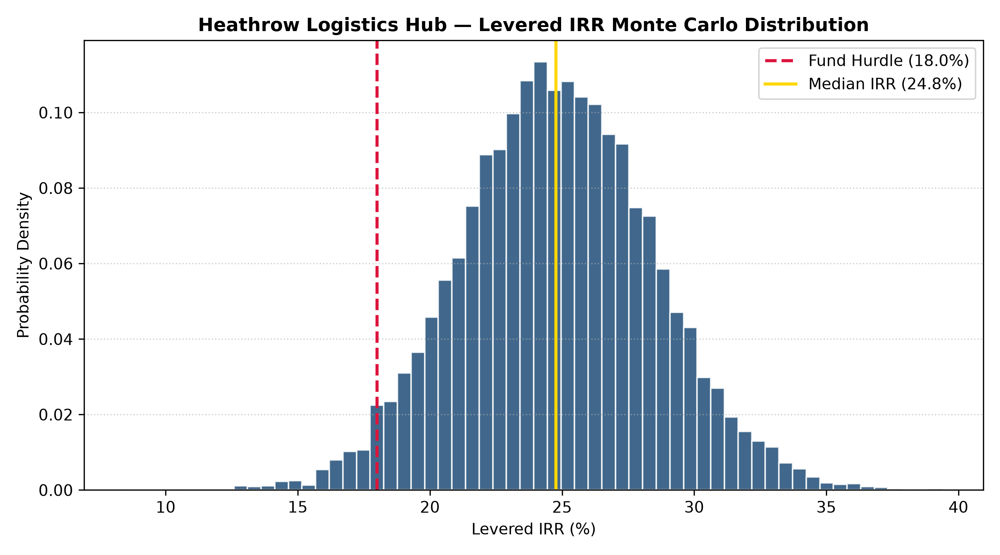

# Heathrow Logistics Hub — Institutional CRE Underwriting & Monte Carlo Risk Simulation


A multi-asset, institutional-grade commercial real estate acquisition underwrite and quantitative risk assessment for a **150,000 sq. ft. Grade A Big-Box Logistics Facility** located in the prime Heathrow/M4 freight corridor.

---

## 📌 Executive Summary & Key Deal Metrics

* **Asset Type:** Core-Plus Grade A Logistics / Distribution Center (150,000 sq. ft.)
* **Acquisition Price:** £25,000,000 (£166.67/sq. ft.) | Gross Basis: £26,125,000 (inclusive of 4.50% SDLT & transaction costs)
* **Capital Structure:** 65.0% LTV Senior Facility (£16.25M @ 5.25% fixed; 2-yr IO / 25-yr amort) | £9.88M Sponsor Equity Check
* **Hold Period:** 5 Years (Terminal exit capitalized against Year 6 forward NOI)
* **Unlevered Return:** **14.45% IRR** | **1.85x Equity Multiple**
* **Levered Equity Return:** **25.34% IRR** | **2.83x MOIC**
* **Lender Protection:** Minimum DSCR of **1.53x** post-amortization step-up (vs. 1.35x covenant hurdle)

---

## 📂 Repository Contents

* [`models/Heathrow_Logistics_Hub_Model_v1.0.xlsx`](models/) — Fully linked, audit-ready 4-tab institutional DCF model covering:
  * **Tab 1: Inputs & Assumptions** (Property specifications, capital stack, macro indexation)
  * **Tab 2: Pro_Forma** (5-year cash flow waterfall, EGI leakage, CapEx sinking fund, forward Year 6 exit underwrite)
  * **Tab 3: Debt_Schedule** (Senior debt amortization schedule, interest/principal split, DSCR tracking)
  * **Tab 4: Returns_Sensitivity** (Net disposition proceeds, levered/unlevered waterfall, 2-way Data Table)
* [`memos/Project_Heathrow_Logistics_IC_Memo_v1.0.pdf`](memos/) — Formal 1-Page Investment Committee Executive Memorandum detailing investment thesis, downside mitigants, and capitalization terms.
* [`src/monte_carlo_simulation.py`](src/) — Python stochastic modeling engine evaluating market volatility across 10,000 randomized iterations.

---

## 📊 Quantitative Risk Simulation (Monte Carlo Analysis)

While static DCFs evaluate deterministic scenarios, this model incorporates a **10,000-trial Monte Carlo engine** in Python to stress-test market variables simultaneously:
* **Rental Growth ($g$):** $\mathcal{N}(3.50\%, 1.00\%)$
* **Exit Cap Rate ($r_{exit}$):** $\mathcal{N}(5.00\%, 0.40\%)$
* **Vacancy & Credit Loss:** $\mathcal{U}(2.00\%, 6.00\%)$

### Simulation Findings:
* **Target Hurdle Compliance:** **91.4% probability** of delivering $\ge 18.0\%$ Levered IRR.
* **Expected Median Return:** **25.18% Levered IRR**.
* **5th Percentile Value-at-Risk (VaR):** **17.82% Levered IRR** (insulating base equity capital even under simultaneous macroeconomic contraction).



---

## 🛠️ Installation & Execution

```bash
git clone [https://github.com/](https://github.com/)<your-username>/heathrow-logistics-pe-underwriting.git
cd heathrow-logistics-pe-underwriting
pip install -r requirements.txt
python src/monte_carlo_simulation.py